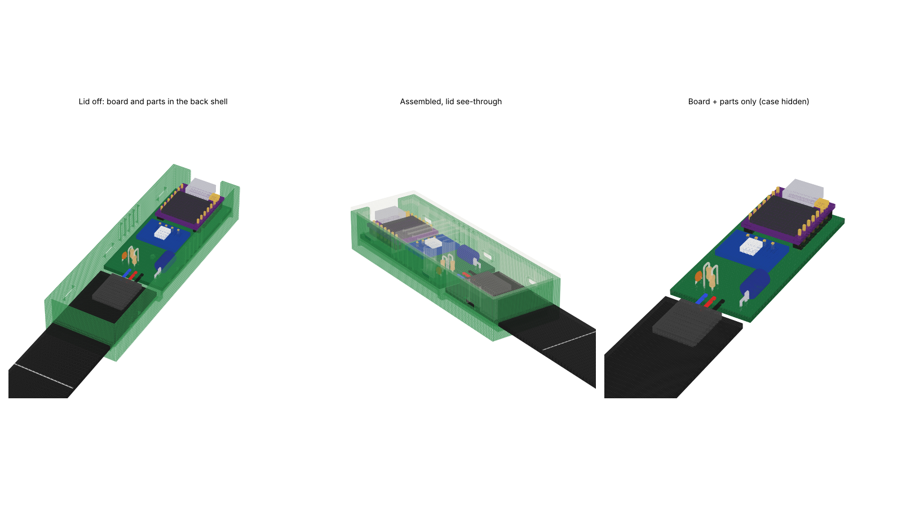
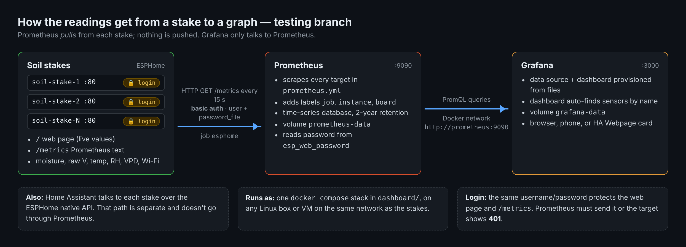
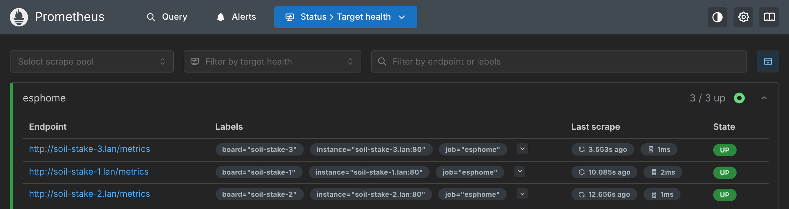
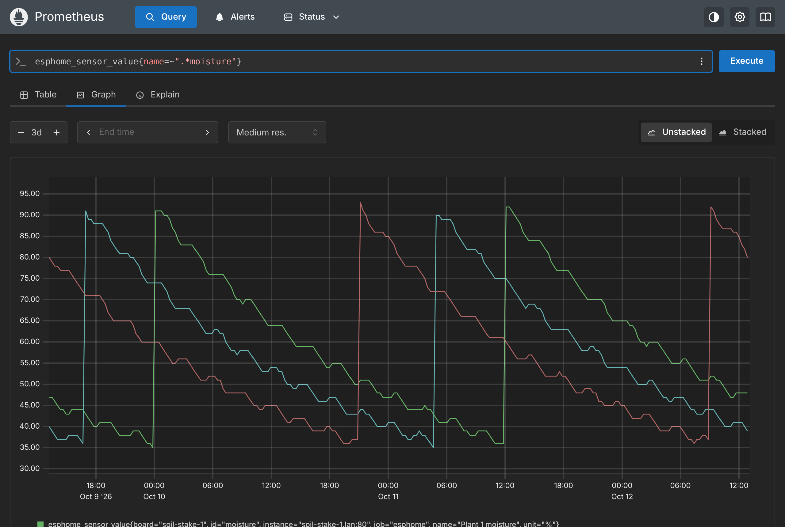
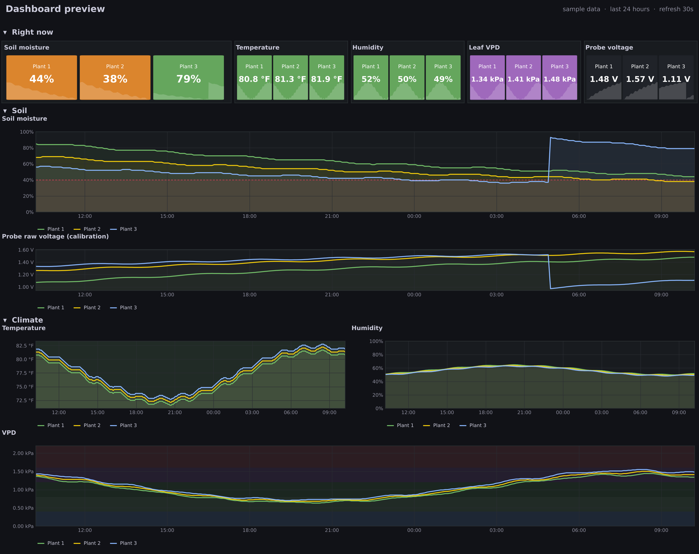
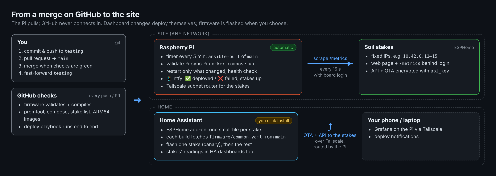

# esp-soil

> **This is the `testing` branch.** It holds changes that are written but not yet running on the stakes or the dashboard server. `main` matches what's deployed right now. To see exactly what's new here, compare the branches: [`main...testing`](https://github.com/gunz0blazin/esp-soil/compare/main...testing). Once a change is flashed and checked on real hardware, it gets merged into `main` with a pull request.
>
> **In testing now**
> - **Deployment pipeline:** merging to `main` deploys the dashboard to the site's Raspberry Pi automatically (`ansible-pull` on a timer, with phone notifications). Firmware is flashed from the ESPHome add-on in Home Assistant, which pulls the shared firmware from `main`. The stakes are reached from home over Tailscale. Every push and pull request is checked on GitHub first. See [Deployment](#deployment) and [`deploy/README.md`](deploy/README.md).
> - **Shared firmware:** `firmware/common.yaml` is used by every stake; each stake has a small file with its number, IP and calibration (`firmware/stakes/`, plus a template for the Home Assistant add-on).
> - **Encryption:** the Home Assistant connection and every firmware update are encrypted with one key (`api_key`). Stakes no longer reboot when Home Assistant isn't connected.
> - **Board login:** the stake web page and `/metrics` require a username and password. Prometheus logs in using a password file. See [Board login](#board-login-testing).
> - **Dashboard stack:** stakes are listed in `dashboard/prometheus/targets/` (adding one needs no restart), image versions are pinned, the Grafana password comes from `.env`, and the dashboard is now called **Soil Monitor**.

Wi-Fi soil moisture stakes. Each stake is a small board with an ESP32-C3, a capacitive soil probe and an AHT10 temperature/humidity sensor in a 3D printed case. Push it into the soil like a plant marker and plug in a USB cable. It reports soil moisture, temperature, humidity and VPD over Wi-Fi to ESPHome / Home Assistant and Prometheus, and the included Grafana stack graphs it.

> **Status:** the breadboard version works and is graphing in Grafana. The stake PCB and snap-fit case are designed but haven't been built yet. The board is now a full KiCad project (`hardware/kicad/`) with the case in its 3D view. Run ERC/DRC there and plot Gerbers from it before ordering.



<!-- toc -->
**Contents**

- [What's in here](#whats-in-here)
- [The stake](#the-stake)
  - [Parts (per stake)](#parts-per-stake)
  - [Pins](#pins)
  - [Case](#case)
  - [Power](#power)
- [Setup](#setup)
- [Calibrating](#calibrating)
  - [Keeping readings honest](#keeping-readings-honest)
- [Data logging: Prometheus + Grafana](#data-logging-prometheus--grafana)
  - [What's in dashboard/](#whats-in-dashboard)
  - [Quick start](#quick-start)
  - [What a stake sends](#what-a-stake-sends)
  - [Prometheus](#prometheus)
  - [Grafana](#grafana)
  - [Viewing on a phone or remotely](#viewing-on-a-phone-or-remotely)
  - [Board login (testing)](#board-login-testing)
  - [Security notes](#security-notes)
  - [Maintenance](#maintenance)
  - [Troubleshooting](#troubleshooting)
- [Deployment](#deployment)
- [VPD](#vpd)
- [Testing on a breadboard](#testing-on-a-breadboard)
- [License](#license)
<!-- /toc -->

---

## What's in here

```
firmware/
  common.yaml              the stake firmware, shared by every stake
  stakes/                  one small file per stake: number, IP, calibration
  ha-stub.example.yaml     template for a stake in the Home Assistant ESPHome add-on
  moisture-test.yaml       breadboard test board: probe + AHT10 + OLED
  moisture-test-probe-only.yaml   same board, probe + OLED only
  legacy/                  the original 4-probe OLED + touch button build
hardware/
  kicad/                   KiCad project: schematic, PCB, 3D models + the case for fit checks
  pcb/                     v1 hand-made Gerbers, build guide PDF
  case/                    snap-fit case (3MF), OpenSCAD file, print notes
  legacy/                  case for the old 4-probe box
dashboard/                 Prometheus + Grafana in Docker, with the dashboard (see Data logging below)
deploy/                    automatic deploy to the site's Raspberry Pi (ansible-pull), setup and Tailscale guides
ci/, .github/workflows/    checks that run on GitHub for every push and pull request
secrets.example.yaml
```

---

## The stake

Each stake reads:

- Soil moisture %, calibrated to its own probe
- Raw probe voltage (for calibrating)
- Temperature and humidity
- Leaf VPD
- Wi-Fi signal

There's no screen. Everything goes to Grafana (see [Data logging](#data-logging-prometheus--grafana)), and there's a small web page on each stake at `http://<stake-ip>/` if you want a quick look.

### Parts (per stake)

| Part | Notes |
|---|---|
| Seeed XIAO ESP32-C3 | On 1x7 headers. Trim the pins under the board. Stick its FPC antenna to the inside of the lid |
| [DFRobot SEN0193](https://www.dfrobot.com/product-1385.html) capacitive soil probe | Cut off the JST plug, solder it straight to the board |
| AHT10 module | Check the pin order is VIN GND SCL SDA. Trim the header pins under the board |
| 10k + 33k resistors | Voltage divider, the C3's ADC tops out around 2.5 V |
| 0.1 µF ceramic cap | ADC noise filter |
| 100 µF electrolytic, 6.3 V+ | 5 mm across, 7 mm long max. Lay it flat |
| Stake PCB | 24 x 52 mm, 2 layers. KiCad project in `hardware/kicad/` |
| Printed case | `hardware/case/`, PETG |
| USB-C cable | Right-angle ones lie flat on the soil |

Everything is through-hole. Open `hardware/kicad/esp-soil-stake.kicad_pro` in KiCad 8+ for the schematic, the board and a 3D view with the case. [`hardware/kicad/README.md`](hardware/kicad/README.md) covers running the checks and making Gerbers. The assembly order is in `hardware/pcb/esp-soil-stake-build.pdf`. That PDF lists M2 screws, but the v2 case snaps together so you don't need them.

### Pins

| XIAO pin | Goes to |
|---|---|
| D1 / GPIO3 | Probe signal, through the 10k/33k divider |
| D4 / GPIO6 | AHT10 SDA |
| D5 / GPIO7 | AHT10 SCL |
| 3V3 / GND | AHT10 and probe power |

### Case

Two parts, snaps together, no screws. Both print without supports. The probe sticks out the bottom through a slot you seal with silicone, and USB-C comes out the top. Print notes and tuning are in [`hardware/case/PRINT-NOTES.md`](hardware/case/PRINT-NOTES.md).


### Power

It runs off USB, about 0.3 W per stake. A multi-port USB charger with a cable to each stake works well. Power banks aren't practical for long-term monitoring: 100 days would take 150,000+ mAh, and many power banks shut off at a draw this low anyway.

---

## Setup

You need [ESPHome](https://esphome.io/) 2026.9 or newer, either the Home Assistant add-on or standalone. The firmware is split in two:

- **`firmware/common.yaml`**: everything the stakes share. You don't flash it directly.
- **One small file per stake**: its number, static IP and calibration, plus your secrets. It pulls in `common.yaml`.

**With the Home Assistant ESPHome add-on** (how the stakes are meant to be managed):

1. Add your secrets to the add-on's **Secrets** (values in [`secrets.example.yaml`](secrets.example.yaml)): Wi-Fi, `web_username` / `web_password`, and `api_key`.
2. Create one device per stake and paste [`firmware/ha-stub.example.yaml`](firmware/ha-stub.example.yaml) into it. Change the values at the top:
   ```yaml
   substitutions:
     plant: "1"            # stake number, used in the sensor names
     node_name: soil-stake-1
     stake_ip: 10.42.0.11  # the stake's static IP (it sets this on itself)
     dry_v: "1.92"         # calibration, see below
     wet_v: "0.92"
   ```
   The stub fetches `common.yaml` from the `main` branch on GitHub every time it builds, so the add-on always flashes the merged firmware.
3. Flash over USB the first time (**Install → Plug into this computer**; browser flashing needs Chrome or Edge). After that it updates over Wi-Fi.
4. Nothing to set on the router: each stake gives itself its `stake_ip` (static) as soon as it joins the Wi-Fi. The network's gateway and subnet mask are set once in `common.yaml` (defaults `10.42.0.1` / `255.255.255.0`); a stake on a different network, like a test probe at home, overrides them in its own file.

**Standalone, from this repo:** copy `secrets.example.yaml` to `firmware/stakes/secrets.yaml`, edit `firmware/stakes/soil-stake-N.yaml`, and run `esphome run firmware/stakes/soil-stake-1.yaml`.

**Keep `api_key` safe** (a password manager). It encrypts both the Home Assistant connection and every firmware update, and a stake flashed with it can only be updated over Wi-Fi with the same key.

The full site setup (Pi, Tailscale, Home Assistant) is in [`deploy/README.md`](deploy/README.md).

---

## Calibrating

Out of the box the % means nothing. Every probe reads a little different, so each stake gets its own dry and wet value.

The probe voltage goes **down** as the soil gets wetter. On the stake you're reading it after the divider, so expect roughly 1.9 V dry and 0.9 V soaked.

1. Watch the stake's **raw** sensor (`Plant N raw`) in Grafana, the stake's web page, or the logs.
2. **Dry:** probe in the air or bone-dry mix. That's `dry_v`.
3. **Wet:** in the soil, watered until it drains, 30 minutes later. That's `wet_v`.
4. Put both in the stake's file (`dry_v` / `wet_v`) and reflash.

0% means "as dry as the dry reference" and 100% means "right after a full watering." It's not actual water content, just a consistent scale.

### Keeping readings honest

- Same depth for every stake, and don't move a stake once it's calibrated. Moving it changes the reading.
- Press the soil firmly around the probe so there's no air gap.
- Only the probe below its line goes in the soil. The case keeps the electronics above it.
- Fertilizer salts slowly push readings up. If the numbers creep up for no reason, redo the wet value.
- The AHT10 sits right at soil level, so it reads warmer and more humid than the air higher up. The ESP also warms the board a bit. Compare against a thermometer you trust once and set the offset in the YAML.

---

## Data logging: Prometheus + Grafana

The stakes don't store any history themselves. A small Docker Compose stack in `dashboard/` does that:

- **Prometheus** visits every stake every 15 seconds, logs in, reads its current values from `http://<stake>/metrics`, and keeps them in a time-series database for 2 years.
- **Grafana** reads from Prometheus and draws the dashboard: current values at the top, history graphs below.



Prometheus *pulls* from the stakes. A stake never sends data anywhere on its own, so if Prometheus is down, readings from that time just aren't recorded (the stakes keep running normally). Home Assistant is a separate path: it talks to each stake over the ESPHome native API and doesn't need Prometheus at all.

### What's in `dashboard/`

| File | What it does |
|---|---|
| `docker-compose.yml` | Runs Prometheus (port 9090) and Grafana (port 3000) at pinned versions, with a named volume for each so data survives restarts and image updates |
| `prometheus/prometheus.yml` | Scrape settings and the board login |
| `prometheus/targets/stakes.yml` | The list of stakes to read. Prometheus re-reads it on its own |
| `prometheus/esp_web_password` | The board password Prometheus logs in with. You create it on the server; it's gitignored. `esp_web_password.example` shows the format |
| `grafana/provisioning/datasources/prometheus.yml` | Connects Grafana to Prometheus automatically (no clicking through the UI) |
| `grafana/provisioning/dashboards/dashboards.yml` | Tells Grafana to load every dashboard JSON in `grafana/dashboards/` |
| `grafana/dashboards/*.json` | The dashboard itself |
| `SETUP.md` | Step-by-step install, phone access and adding stakes |

### Quick start

On the site's Raspberry Pi this is all automatic: see [Deployment](#deployment). To run the stack by hand on any Linux machine with Docker:

```bash
cd dashboard
nano prometheus/targets/stakes.yml                                # one entry per stake, see below
printf '%s' 'your-long-password' > prometheus/esp_web_password    # same as web_password on the stakes
chmod 644 prometheus/esp_web_password
echo 'GRAFANA_ADMIN_PASSWORD=pick-one' > .env                     # used the first time Grafana starts
docker compose up -d
```

- Grafana: `http://<server-ip>:3000`, user `admin`. The dashboard opens as the home page.
- Prometheus: `http://<server-ip>:9090`. Check **Status → Target health** first: every stake should say **UP**.

Any Linux machine, VM or container host on the same network as the stakes works. The whole stack is light: a few hundred MB of RAM, and storage is small (see [Storage and retention](#storage-and-retention)).

---

### What a stake sends

With `web_server:` and `prometheus:` in the firmware, each stake serves its sensor values as plain text at `/metrics`, behind the board login. You can open it in a browser (it asks for the username and password) or `curl` it with `-u`:

```text
$ curl -u esp:your-long-password http://192.168.1.XXX/metrics
#TYPE esphome_sensor_value gauge
#TYPE esphome_sensor_failed gauge
esphome_sensor_value{id="probe_raw",name="Plant 1 raw",unit="V"} 1.455
esphome_sensor_failed{id="probe_raw",name="Plant 1 raw"} 0
esphome_sensor_value{id="moisture",name="Plant 1 moisture",unit="%"} 46
esphome_sensor_failed{id="moisture",name="Plant 1 moisture"} 0
...
```

Every sensor becomes one `esphome_sensor_value` line. The `name` label is the sensor's name from the YAML, and that's what the dashboard and the queries below match on. `esphome_sensor_failed` is `1` when a sensor has no valid reading (for example the AHT10 isn't responding). The exact set of labels can vary a little between ESPHome versions.

| Sensor (`name`) | Unit | How often the stake updates it |
|---|---|---|
| `Plant N raw` | V | every 10 s (median of the last 7 samples, sampled every 5 s) |
| `Plant N moisture` | % | every 10 s (calculated from the raw value) |
| `Plant N temperature` | °C | every 15 s |
| `Plant N humidity` | % | every 15 s |
| `Plant N leaf VPD` | kPa | every 15 s |
| `Plant N WiFi` | dBm | every 60 s |

`N` is the `plant` value in each stake's file. Prometheus scrapes every 15 s and records whatever the latest value is at that moment.

---

### Prometheus

#### Configuration

`dashboard/prometheus/prometheus.yml`:

```yaml
global:
  scrape_interval: 15s          # how often every stake is read

scrape_configs:
  - job_name: esphome
    metrics_path: /metrics
    basic_auth:                 # the board login, sent on every scrape
      username: esp             # must match web_username on the stakes
      password_file: /etc/prometheus/esp_web_password
    file_sd_configs:            # the list of stakes, in its own file
      - files:
          - /etc/prometheus/targets/*.yml
        refresh_interval: 1m
```

`dashboard/prometheus/targets/stakes.yml`:

```yaml
- targets: ["10.42.0.11:80"]      # the stake's static IP and web_server port
  labels: {board: soil-stake-1}   # extra label so you can tell stakes apart
- targets: ["10.42.0.12:80"]
  labels: {board: soil-stake-2}
```

- **`basic_auth`** applies to every stake in the job, so all stakes share one username and password. Stakes still on firmware without a login just ignore it.
- **One entry per stake** in `targets/stakes.yml`. The `board` label is added to every value from that stake, which makes queries and graphs easier to read.
- **Adding or removing a stake needs no restart:** Prometheus re-reads the targets file within a minute.
- **Each stake's IP here must match `stake_ip` in its firmware file.** The GitHub checks compare the two and fail if they don't.
- **After editing `prometheus.yml` itself**, apply it with `docker compose restart prometheus`. A restart doesn't lose any data. (The Pi's deploy does this for you, and only when that file changed.)

Prometheus also adds two labels on its own: `job="esphome"` and `instance="<ip>:80"`. It also records a few series per stake about the scrape itself, the most useful being `up`, which is `1` when the last read worked and `0` when it didn't.

#### Checking the stakes are being read

Open `http://<server-ip>:9090/targets` (**Status → Target health**). Every stake should be **UP**, with a recent "Last scrape" time.



If a stake shows **DOWN**, the error under it says why. In the screenshot (sample data), stake 3 has a different password from the one Prometheus is sending, so it's rejected with **401 Unauthorized** while the other two log in fine. The usual causes are in [Troubleshooting](#troubleshooting).

#### Querying

The **Query** page runs PromQL and can graph the result. This is useful for one-off questions the dashboard doesn't answer, and for testing a query before you put it in a Grafana panel.



*Sample data: three stakes over three days. Each sharp rise is a watering, followed by a slow dry-down.*

Queries that are handy for this project (all tested):

| What you want | PromQL |
|---|---|
| Current moisture, every stake | `esphome_sensor_value{name=~".*moisture"}` |
| Driest reading in the last 24 h | `min_over_time(esphome_sensor_value{name=~".*moisture"}[24h])` |
| Dry-down rate in % per hour (negative = drying) | `deriv(esphome_sensor_value{name=~".*moisture"}[1h]) * 3600` |
| Rough hours until a stake reaches 40% | `(esphome_sensor_value{name=~".*moisture"} - 40) / -(deriv(esphome_sensor_value{name=~".*moisture"}[3h]) * 3600) > 0` |
| Stakes that aren't responding | `up{job="esphome"} == 0` |
| Average temperature over the last day (°C) | `avg_over_time(esphome_sensor_value{name=~".*temperature"}[1d])` |
| Wi-Fi signal per stake | `esphome_sensor_value{name=~".*WiFi"}` |
| How many sensors each stake reports | `count by (board) (esphome_sensor_value)` |

The "hours until 40%" estimate only returns a value for stakes that are currently drying and are still above 40%. It's a straight-line projection from the last 3 hours, so treat it as a rough guide.

#### Storage and retention

- History is kept for **2 years** (`--storage.tsdb.retention.time=2y` in `docker-compose.yml`). Older data is deleted automatically.
- Data lives in the `prometheus-data` Docker volume, so it survives `docker compose restart`, `down`/`up` and image updates.
- Each stake produces about a dozen series at one sample every 15 s. Prometheus compresses this well, so two years for one stake comes to well under 100 MB.

---

### Grafana

#### Provisioning (set up from files)

Grafana is configured entirely from files in `dashboard/grafana/`, so a fresh install comes up ready to use:

- **Data source:** `provisioning/datasources/prometheus.yml` adds Prometheus at `http://prometheus:9090` (the container name on the Compose network) and makes it the default.
- **Dashboard:** `provisioning/dashboards/dashboards.yml` loads every JSON file in `grafana/dashboards/`. `docker-compose.yml` sets the bundled dashboard as Grafana's home page.
- **Other settings** (in `docker-compose.yml`): dark theme by default, and embedding is allowed so the dashboard can be shown inside a Home Assistant **Webpage** card.

UI edits to the dashboard are allowed and get saved in Grafana's own database. To keep a change for good (and in git), export it as JSON (**Export → Export as JSON**) and replace the file in `grafana/dashboards/`.

#### The dashboard



*Preview drawn from the dashboard file with sample data for three stakes. Panel layout, queries, units and color thresholds match the JSON; Grafana's own styling differs slightly.*

The default view is the last 24 hours, refreshing every 30 seconds.

**Right now** — stat tiles with the latest value, colored by threshold, and a sparkline of the time range:

| Panel | Shows | Colors |
|---|---|---|
| Soil moisture | Every `…moisture` sensor, one tile per stake | red under 30%, orange 30–45%, green 45–85%, blue 85%+ |
| Temperature | Every `…temperature` sensor, converted to °F | blue under 70, green 70–85, orange 85–90, red 90+ °F |
| Humidity | Every `…humidity` sensor | orange under 40%, green 40–70%, blue 70%+ |
| Leaf VPD | Every `…leaf…vpd` sensor | blue under 0.4, light green 0.4–0.8, green 0.8–1.2, purple 1.2–1.6, red 1.6+ kPa |
| Probe voltage | Every `…raw` sensor | none (for calibration) |

**Soil**

- **Soil moisture**: history for every stake, 0–100%, with a dashed line and red shading below 40%.
- **Probe raw voltage (calibration)**: the voltage behind each moisture reading. Use it to pick `dry_v` and `wet_v` (see [Calibrating](#calibrating)).

**Climate**

- **Temperature** (°F) with the 70–85 °F band shaded.
- **Humidity** (%).
- **VPD** (kPa) with the same color bands as the Leaf VPD tile.

#### How new stakes show up

The panels don't list stakes one by one. Each query matches sensor *names* with a case-insensitive pattern, for example:

```promql
esphome_sensor_value{name=~"(?i).*moisture.*"}
```

So as soon as Prometheus is reading a new stake, its moisture, temperature, humidity, VPD and raw voltage appear on the dashboard with no Grafana changes. This also means a sensor needs one of those words in its name to be picked up.

Every tile and graph line is labelled by stake (**Plant 1**, **Plant 2**, …), taken from the sensor name. Each query wraps the match in `label_replace` to build that label:

```promql
label_replace(label_replace(esphome_sensor_value{name=~"(?i).*moisture.*"},
  "stake", "$1", "name", "(.*)"),                 # default: the full sensor name
  "stake", "Plant $1", "name", "Plant ([0-9]+) .*")  # stake firmware: "Plant N"
```

The panels use `{{stake}}` as their legend. A sensor whose name doesn't start with `Plant N` still shows up, under its full name.

#### Known limitations

- **Leaf VPD tile vs VPD graph:** the tile matches `leaf…vpd`, the graph matches any sensor with `vpd` in its name. With the stake firmware they show the same sensors.
- Short gaps (a stake rebooting, a missed scrape) are bridged on the graphs if they're under 5 minutes. Longer gaps show as breaks.

---

### Viewing on a phone or remotely

- **On your home network:** open `http://<server-ip>:3000` and use "Add to Home Screen". Panels stack into one column on a narrow screen.
- **Away from the site:** over Tailscale, at `http://<pi-tailscale-name>:3000` (set up in [`deploy/README.md`](deploy/README.md#2-tailscale-reach-the-site-from-home)). Don't open ports 3000 or 9090 to the internet.
- **Inside Home Assistant:** add a **Webpage** card or dashboard pointing at `http://<server-ip>:3000/d/soil-monitor?kiosk`. `?kiosk` hides Grafana's menus.

More detail is in [`dashboard/SETUP.md`](dashboard/SETUP.md).

### Board login (testing)

Each stake's web page and `/metrics` sit behind one username and password, set in ESPHome's `secrets.yaml`:

```yaml
# secrets.yaml (next to the firmware, gitignored)
web_username: "esp"
web_password: "your-long-password"
```

```yaml
# firmware/common.yaml (the values come from each stake file's secrets)
web_server:
  port: 80
  auth:
    username: ${web_username}
    password: ${web_password}
    type: basic
```

**How it works**

- The login covers everything the web server serves: the live web page *and* `/metrics`. That's why Prometheus has to log in too.
- Prometheus sends the username from `prometheus.yml` and reads the password from `prometheus/esp_web_password`, which `docker-compose.yml` mounts into the container. The password never goes in git.
- Every stake uses the same login, because one scrape job sends one set of credentials.
- **`type: basic` is required.** Prometheus only does basic auth. ESPHome currently defaults to basic, but the default switches to digest in ESPHome 2027.1, so the firmware sets it explicitly.

**Rolling it out** (order matters)

1. Add `web_username` / `web_password` to ESPHome's `secrets.yaml`.
2. On the server, put the same password in `prometheus/esp_web_password`. On the Pi that's `/etc/esp-soil/esp_web_password`, and the deploy copies it in. By hand: `chmod 644` it and run `docker compose up -d --force-recreate prometheus`. Create the file *before* the container starts: if it's missing, Docker creates a folder with that name and every scrape fails.
3. OTA the stakes one at a time. Boards without a login ignore the credentials, so nothing breaks while some stakes are updated and some aren't.
4. Check `http://<server-ip>:9090/targets`: every stake should be **UP**.

**Checking a stake by hand**

```bash
curl -s -o /dev/null -w '%{http_code}\n' http://<stake-ip>/metrics        # 401 = login is on
curl -s -u esp:your-long-password http://<stake-ip>/metrics | head     # readings come back
```

**Changing the password:** update `web_password` and OTA every stake, then update `prometheus/esp_web_password` and restart Prometheus. Stakes show **401** in between, so do it in one sitting.

### Security notes

- **The stakes have a login,** but it's HTTP basic auth over plain HTTP. The password is only base64-encoded, so anyone who can capture traffic on your network could read it. It stops casual access to the web page and readings; keep the stakes on a network you trust (a separate VLAN for IoT devices is a good idea).
- **Use a password that isn't used anywhere else,** since it's stored in plain text in `secrets.yaml` and `esp_web_password`.
- **The Grafana admin password** comes from `GRAFANA_ADMIN_PASSWORD` in `dashboard/.env` (on the Pi, from `/etc/esp-soil/grafana_admin_password`). It's only applied the first time Grafana starts; after that, change it in Grafana.
- **Prometheus (9090) has no login.** Keep it on your local network.

### Maintenance

| Task | How |
|---|---|
| Add a stake | Flash it with the same secrets, and add an entry to `prometheus/targets/stakes.yml`. No restart needed. Full steps: [`deploy/README.md`](deploy/README.md#adding-a-stake) |
| Change the board password | See [Board login](#board-login-testing) |
| Remove a stake | Delete its block and restart Prometheus. Its old history stays until it ages out |
| Update Prometheus and Grafana | Change the pinned version in `docker-compose.yml` on `testing`. The checks confirm the new tag exists with an ARM64 build; after the merge, the Pi pulls it |
| Back up the history | Stop Prometheus (`docker compose stop prometheus`), copy the `prometheus-data` volume (named `esp-soil_prometheus-data` on the Pi, `dashboard_prometheus-data` if you started it by hand from `dashboard/`), then start it again |
| Reset Grafana settings | Remove the `grafana-data` volume. The data source and dashboard come back from the provisioning files on the next start |

Don't run `docker compose down -v` unless you mean it: `-v` deletes both volumes, including all history.

### Troubleshooting

| Symptom | Likely cause | Fix |
|---|---|---|
| Target **DOWN**, "connection refused" or timeout | Stake is off, on a different IP, or not on Wi-Fi | Check the stake's IP in your router and open `http://<ip>/metrics` from the server |
| Target **DOWN**, "401 Unauthorized" | The stake's password or username doesn't match what Prometheus sends | Compare `web_username` / `web_password` with `prometheus.yml` and `esp_web_password` (no trailing newline; `printf '%s'` avoids one) |
| Every target **DOWN** with an error about the password file | `esp_web_password` didn't exist when the container started, so Docker made a folder | `docker compose down`, delete the folder, create the file, `docker compose up -d` |
| Browser asks for a login on the stake's page | Expected on this branch | Use `web_username` / `web_password` |
| Target **DOWN**, "404 Not Found" | Firmware is missing `prometheus:` | Add `web_server:` and `prometheus:` to the YAML and reflash |
| Target **UP** but the stake isn't on the dashboard | Sensor names don't contain `moisture`, `temperature`, `humidity`, `vpd` or `raw` | Check the names at `/metrics` |
| Whole dashboard says "No data" | Grafana can't reach Prometheus | Both containers must be in the same Compose stack; check **Connections → Data sources → Prometheus → Test** |
| History is gone after a restart | A volume was removed | Use `restart` or `down`/`up`, not `down -v` |
| Graph times look shifted | Grafana uses the browser's time zone | Change it in the dashboard settings or your Grafana profile |

---

## Deployment

The stakes and a Raspberry Pi live at a site that can be off your home network. The Pi runs Prometheus and Grafana; Home Assistant at home manages the stakes' firmware over Tailscale.



| What changed on `main` | What happens |
|---|---|
| `dashboard/` (Prometheus, Grafana, the list of stakes) | **Automatic.** The Pi checks GitHub every 5 minutes. On a new commit it validates the config, deploys it, restarts only what changed, checks everything is healthy, and sends a phone notification with how many stakes it can reach. A bad config is rejected before anything live changes |
| `firmware/` | **You choose when.** Each stake's file in the ESPHome add-on pulls `firmware/common.yaml` from `main`. Flash one stake, check it, then the rest |
| `deploy/` | The Pi updates its own deploy command and timer |

**How work flows**

1. Make changes on `testing` and push. GitHub runs the checks (below) on every push.
2. Open a pull request into `main`. Merge when the checks are green.
3. The Pi deploys dashboard changes on its own; firmware gets flashed from the add-on.
4. Fast-forward `testing` to `main`, so `testing` only ever shows new, unmerged work.

**Checks on every push and pull request** (`.github/workflows/checks.yml`, on GitHub's runners with throwaway secrets, so it's safe on a public repo):

- every stake file and the Home Assistant stub validate with the pinned ESPHome version, and the firmware compiles
- `promtool` accepts the Prometheus config; the compose file and the list of stakes are valid; the pinned images exist with ARM64 builds for the Pi
- the deploy playbook runs end to end on the runner, a second run changes nothing, Grafana loads the dashboard and Prometheus finds every stake

**Why the Pi pulls instead of GitHub pushing:** nothing on the internet can make the Pi run code. It only ever pulls `main`, and only you can merge to `main`. No ports are opened at the site.

**First deployment, in order:** [Going live, step by step](deploy/README.md#going-live-step-by-step).

**Setting it up** (Pi bootstrap, secrets, notifications, the ESPHome add-on, day-to-day steps, rollbacks and troubleshooting): [`deploy/README.md`](deploy/README.md). Remote access to the site: [`deploy/TAILSCALE.md`](deploy/TAILSCALE.md).

---

## VPD

Leaf VPD (vapor pressure deficit) is calculated from the AHT10's temperature and humidity. It assumes the leaf surface is slightly cooler than the air; the offset is `leaf_offset_c` in the YAML, default 2 °C.

---

## Testing on a breadboard

`firmware/moisture-test.yaml` is the pre-PCB test build: an ESP32 DevKit with one probe, an AHT10 and a 0.96" OLED showing moisture, temp, RH and VPD.

| Part | ESP32 pin |
|---|---|
| Probe signal | GPIO32 |
| OLED SDA / SCL | GPIO21 / GPIO22 |
| AHT10 SDA / SCL | GPIO25 / GPIO26 |

Lessons from the breadboard build:

- **Keep probes on ADC1 pins (GPIO32–35).** ADC2 stops working when Wi-Fi is on.
- **Give the AHT10 its own I2C bus.** It can lock up a shared bus and take the OLED down with it.
- **Check your OLED's pin order.** Some are GND-VCC-SCL-SDA and some are VCC-GND-SCL-SDA.
- **Cheap probes:** look at the chip. You want **TLC555**, not **NE555**. The NE555 ones don't behave at 3.3 V.
- **No probes yet?** A 10k potentiometer works: outer legs to 3V3 and GND, middle leg to the probe pin. Turn it and watch the % move.

The original 4-probe box with touch buttons is still in `firmware/legacy/` and `hardware/legacy/` if anyone wants a single-box version.

---

## License

See [`LICENSE`](LICENSE).
