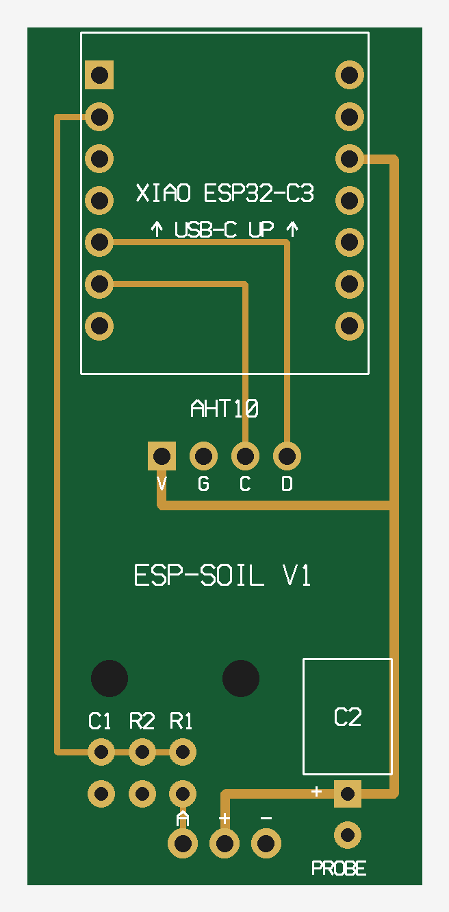
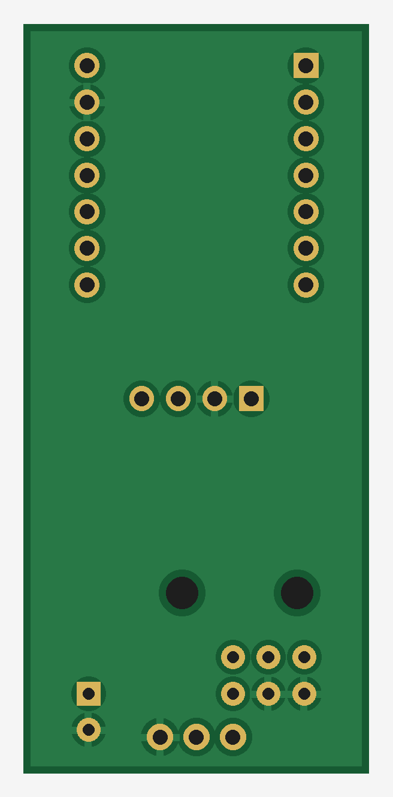

# esp-soil

Soil moisture stakes for my grow tent. Each pot gets one: a little board with an ESP32, a capacitive soil probe and an AHT10 for temp and humidity, in a 3D printed case. You push the whole thing into the soil like a plant marker and plug in a USB cable. It reports moisture, temperature, humidity and VPD over Wi-Fi, and I graph it all in Grafana.

I built it because "water when it starts to wilt" was a bad system, and weighing pots wasn't consistent enough. My partner helps with watering, so I wanted a dashboard either of us can check on a phone.

> **Status:** the breadboard version works and is graphing in Grafana. The stake PCB and snap-fit case are designed but haven't been built yet. The PCB was laid out without KiCad, so check the Gerbers in your fab's viewer before ordering.

<p>
  
  
</p>

---

## What's in here

```
firmware/
  soil-stake.yaml          the stake firmware (one per pot)
  moisture-test.yaml       breadboard test board with an OLED
  legacy/                  the original 4-probe OLED + touch button build
hardware/
  pcb/                     Gerbers, build guide PDF, generator scripts
  case/                    snap-fit case (3MF), OpenSCAD file, print notes
  legacy/                  case for the old 4-probe box
dashboard/                 Prometheus + Grafana in Docker, with the dashboard
secrets.example.yaml
```

---

## The stake

Each stake reads:

- Soil moisture %, calibrated to its own probe
- Raw probe voltage (for calibrating)
- Temperature and humidity
- Leaf VPD
- Wi-Fi signal

There's no screen. Everything goes to Grafana, and there's a small web page on each stake at `http://<stake-ip>/` if you want a quick look.

### Parts (per stake)

| Part | Notes |
|---|---|
| Seeed XIAO ESP32-C3 | On 1x7 headers |
| [DFRobot SEN0193](https://www.dfrobot.com/product-1385.html) capacitive soil probe | Cut off the JST plug, solder it straight to the board |
| AHT10 module | Check the pin order is VIN GND SCL SDA |
| 10k + 33k resistors | Voltage divider, the C3's ADC tops out around 2.5 V |
| 0.1 µF ceramic cap | ADC noise filter |
| 100 µF electrolytic, 6.3 V+ | Lay it flat |
| Stake PCB | 24 x 52 mm, 2 layers. Gerbers in `hardware/pcb/` |
| Printed case | `hardware/case/`, PETG |
| USB-C cable | Right-angle ones lie flat on the soil |

Everything is through-hole. The full schematic, layout and assembly order are in `hardware/pcb/esp-soil-stake-build.pdf`. That PDF lists M2 screws, but the v2 case snaps together so you don't need them.

### Pins

| XIAO pin | Goes to |
|---|---|
| D1 / GPIO3 | Probe signal, through the 10k/33k divider |
| D4 / GPIO6 | AHT10 SDA |
| D5 / GPIO7 | AHT10 SCL |
| 3V3 / GND | AHT10 and probe power |

### Case

Two parts, snaps together, no screws. Both print without supports. The probe sticks out the bottom through a slot you seal with silicone, and USB-C comes out the top. Print notes and tuning are in [`hardware/case/PRINT-NOTES.md`](hardware/case/PRINT-NOTES.md).


### Power

It runs off USB, about 0.3 W per stake. I use one multi-port USB charger outside the tent with a cable to each pot. A power bank won't last a grow: it would take 150,000+ mAh for 100 days, and lots of power banks shut off at a draw this low anyway.

---

## Setup

You need [ESPHome](https://esphome.io/), either standalone or the Home Assistant add-on.

1. Copy `secrets.example.yaml` to `secrets.yaml` and fill in your Wi-Fi. It's in `.gitignore`.
2. Open `firmware/soil-stake.yaml` and change the top for each stake:
   ```yaml
   substitutions:
     plant: "1"
     node_name: soil-stake-1
   ```
3. Flash over USB the first time. After that it updates over Wi-Fi.
   ```bash
   esphome run firmware/soil-stake.yaml
   ```
   Browser flashing (ESPHome Web) needs Chrome or Edge. Firefox doesn't do Web Serial.
4. Give each stake a fixed IP in your router.

---

## Calibrating

Out of the box the % means nothing. Every probe reads a little different, so each stake gets its own dry and wet value.

The probe voltage goes **down** as the soil gets wetter. On the stake you're reading it after the divider, so expect roughly 1.9 V dry and 0.9 V soaked.

1. Watch **Plant N raw** in Grafana, the stake's web page, or the logs.
2. **Dry:** probe in the air or bone-dry mix. That's `dry_v`.
3. **Wet:** in its pot, watered to runoff, 30 minutes later. That's `wet_v`.
4. Put both in the substitutions and reflash.

0% means "as dry as my reference" and 100% means "right after a full watering." It's not actual water content, just a consistent scale.

### Keeping readings honest

- Same depth in every pot, and don't move a stake during the grow. Moving it changes the reading.
- Press the soil firmly around the probe so there's no air gap.
- Only the probe below its line goes in the soil. The case keeps the electronics above it.
- Fertilizer salts slowly push readings up. If the numbers creep up for no reason, redo the wet value.
- The AHT10 sits right at soil level, so it reads warmer and more humid than the canopy. The ESP also warms the board a bit. Compare against a thermometer you trust once and set the offset in the YAML.

---

## Grafana dashboard

`dashboard/` is a Docker Compose stack: Prometheus scrapes each stake's `/metrics` every 15 s and keeps 2 years of data, and Grafana draws the graphs. The dashboard picks up any sensor with "moisture", "temperature", "humidity" or "VPD" in its name, so new stakes show up on their own.

```bash
cd dashboard
nano docker-compose.yml          # change the Grafana admin password
nano prometheus/prometheus.yml   # add your stakes' IPs
docker compose up -d
```

Grafana is on `:3000`. More detail, including viewing it on your phone, is in [`dashboard/SETUP.md`](dashboard/SETUP.md).

---

## VPD

Leaf VPD assumes the leaves are a bit cooler than the air, which is normal under LEDs. The offset is `leaf_offset_c` in the YAML, default 2 °C.

| Leaf VPD (kPa) | Good for |
|---|---|
| under 0.4 | too low |
| 0.4 – 0.8 | seedlings / clones |
| 0.8 – 1.2 | veg |
| 1.2 – 1.6 | flower |
| over 1.6 | too high |

---

## Testing on a breadboard

`firmware/moisture-test.yaml` is what I used before the PCB: an ESP32 DevKit with one probe, an AHT10 and a 0.96" OLED showing moisture, temp, RH and VPD.

| Part | ESP32 pin |
|---|---|
| Probe signal | GPIO32 |
| OLED SDA / SCL | GPIO21 / GPIO22 |
| AHT10 SDA / SCL | GPIO25 / GPIO26 |

Stuff I learned the annoying way:

- **Keep probes on ADC1 pins (GPIO32–35).** ADC2 stops working when Wi-Fi is on.
- **Give the AHT10 its own I2C bus.** It can lock up a shared bus and take the OLED down with it.
- **Check your OLED's pin order.** Some are GND-VCC-SCL-SDA and some are VCC-GND-SCL-SDA.
- **Cheap probes:** look at the chip. You want **TLC555**, not **NE555**. The NE555 ones don't behave at 3.3 V.
- **No probes yet?** A 10k pot works: outer legs to 3V3 and GND, middle leg to the probe pin. Turn it and watch the % move.

The original 4-probe box with touch buttons is still in `firmware/legacy/` and `hardware/legacy/` if anyone wants a single-box version.

---

## License

MIT. Do whatever you want with it. If you build one and improve it, I'd like to see it.
