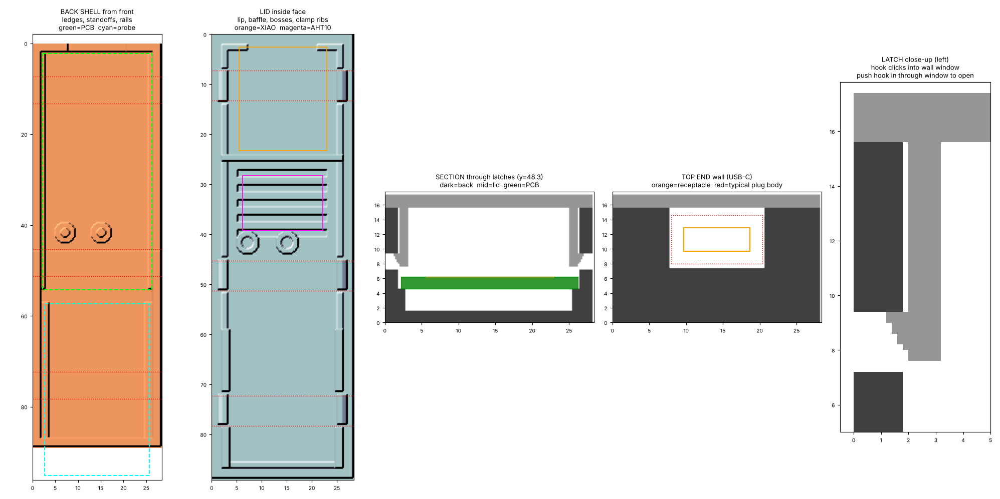

# Stake case v2 (snap-fit)

Fits the 24 x 52 mm ESP-Soil stake PCB + DFRobot SEN0193. Outer size is 28.4 x 89.1 x 17.3 mm with the lid on. No screws.



## How it closes

Six flexible arms hang down from the lid, three per long side. Each one has a hook that clicks into a small window in the back shell wall. The two posts in the back shell have pins that go through the PCB mounting holes, and the lid bosses press down on the board, so the board is held without screws too.

## Printing

The models are 3MF (a zipped mesh, opens in PrusaSlicer, Bambu Studio, Orca and Cura). They're about 4 MB instead of 30 MB as STL. If you need STLs, run the generator below and they land in `source/out/`.

| File | Orientation |
|---|---|
| `stake-case-back.3mf` | Open side up, floor on the bed. No supports. |
| `stake-case-lid.3mf` | Already flipped: outer face on the bed, latch arms pointing up. No supports. |

- PETG. The arms need to flex, and PLA goes soft in a warm humid tent. ASA works too.
- 0.2 mm layers, 3 walls, 20%+ infill.
- Don't scale the model. The latch clearances are only 0.2 mm.

## Assembly

1. Solder the probe's 3 leads to the PCB (A + -), keep them about 3 mm.
2. Drop the PCB onto the two pins (USB-C at the top notch) and push the probe tip out through the bottom slot. The probe rests on the side rails.
3. Seal the bottom slot from the inside with silicone (RTV or aquarium silicone) around the probe.
4. Line up the lid (vents over the AHT10) and press straight down until all 6 hooks click. Squeeze the sides near a window if one is stubborn.

**Opening it:** push each hook inward through its window with a small flat screwdriver or a paperclip while lifting that side of the lid. Do one side, then the other.

## Tuning

Everything is generated by `source/gen_case.py` (needs numpy + scikit-image). Edit the parameters at the top, then:

```bash
cd source
python3 gen_case.py   # 3MF + STL + .scad land in source/out/
python3 render.py     # preview.png
```

| Problem | Change |
|---|---|
| Too tight, arms turn white | `hook_h` 0.8 → 0.6, or `arm_t` 1.2 → 1.0 (`arm_len` is already near its max of ~8.5) |
| Too loose, pops open | `hook_h` 0.8 → 1.0, or `arm_t` 1.2 → 1.4 |
| Want screws too | `use_screws = True` (pins become M2 pilot holes, use M2 x 16 self-tappers) |
| Move the latches | `snap_y` (stay clear of the side vents at y ≈ 27–41) |

`stake-case.scad` has the same geometry if you'd rather work in OpenSCAD.

## Fit checks

Measure your parts before printing a batch.

- The XIAO on headers has to be under about 9.5 mm tall above the PCB (`front_clear`).
- The probe keeps 30 mm (its electronics end) inside the case. Its "max depth" line has to sit **below** the case bottom. Change `probe_in` if your probe's line is further down.
